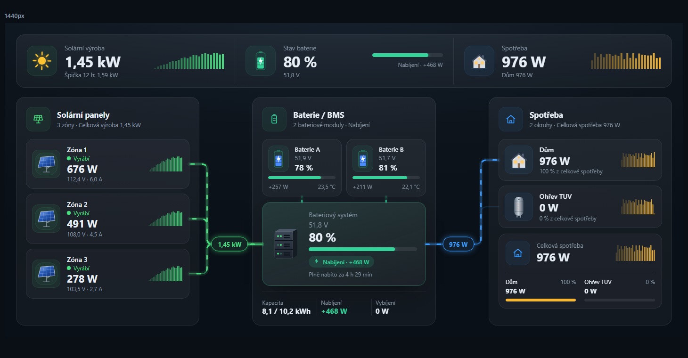
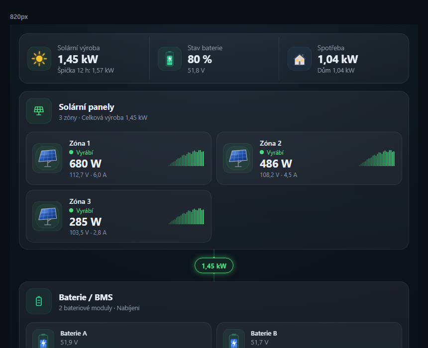
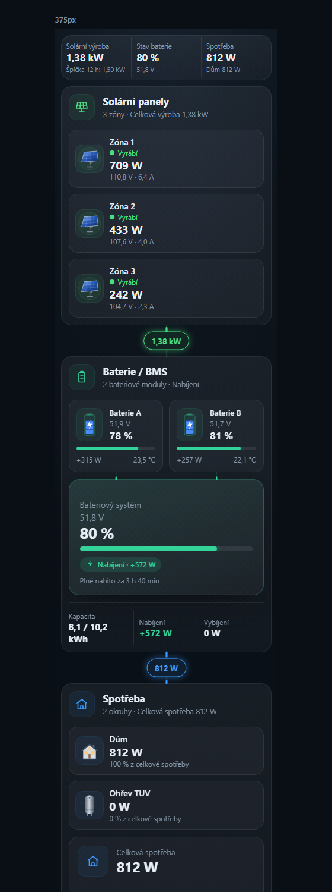
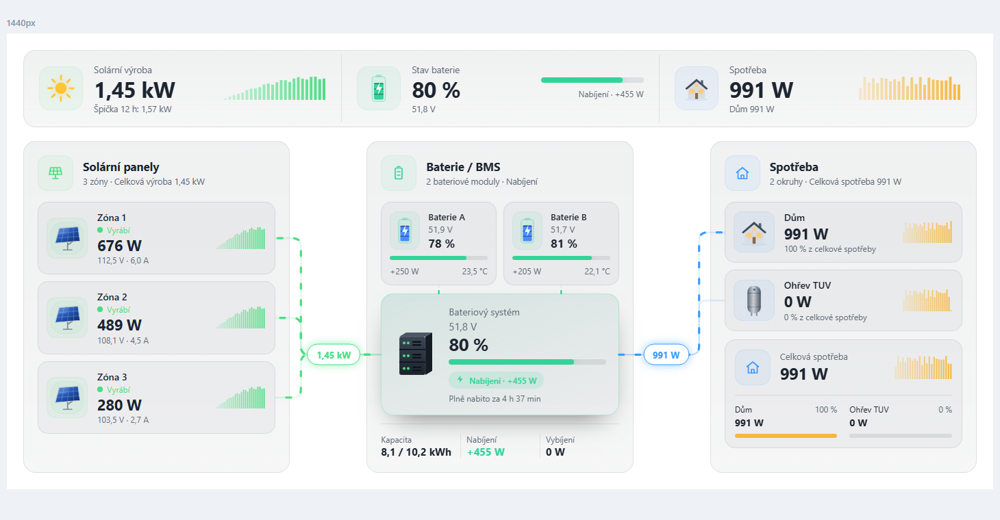

# Bugsa Solar Card

Animovaná karta pro Home Assistant, která na jednom místě ukazuje celou solární elektrárnu — **výrobu** z panelů, **uložení** v bateriích (BMS) a **spotřebu** v jednotlivých okruzích (domácnost, ohřev TUV…).



- **Libovolný počet** solárních zón/stringů, bateriových modulů a spotřebičů.
- **Animované toky energie** — rychlost odpovídá výkonu, směr u baterie podle nabíjení/vybíjení.
- **Responzivní**: 3 sloupce na desktopu, skládané sekce na tabletu a mobilu (řízeno šířkou karty, ne okna).
- **Sparkline grafy** z dlouhodobých statistik recorderu (levné 5min/hodinové průměry) doplňované živě.
- **Odhad času** do plného nabití / vybití, vážené SOC podle kapacity, přepočet jednotek (W/kW, V/mV, A/mA, Wh/kWh/Ah).
- **Světlé i tmavé téma** (přebírá barvy z HA, nebo vynucený tmavý vzhled), vlastní barvy, CZ/EN.
- **Nenáročná**: ~45 kB minifikováno, žádné runtime závislosti, DOM se staví jednou a dál se mění jen texty; animace jen přes `transform`/`opacity`/`stroke-dashoffset`, pauza mimo viewport, respektuje `prefers-reduced-motion`.

| Tablet | Mobil | Světlé téma |
|---|---|---|
|  |  |  |

## Instalace

### HACS (vlastní repozitář)
1. HACS → ⋮ → *Custom repositories* → URL tohoto repozitáře, typ **Dashboard**.
2. Nainstalujte **Bugsa Solar Card** a obnovte prohlížeč.

### Ručně
1. Zkopírujte `dist/bugsa-solar-card.js` do `/config/www/`.
2. *Nastavení → Ovládací panely → ⋮ → Zdroje* → přidejte `/local/bugsa-solar-card.js` jako **JavaScript modul**.

## Nastavení (i z mobilu)

1. Ovládací panel → *Upravit* → *Přidat kartu* → **Bugsa Solar Card**. Karta se ukáže s ukázkovými daty.
2. V sekci **Solární panely** klepněte na *Přidat panely / zónu* a vyberte **senzor výkonu**.
3. V sekci **Baterie** klepněte na *Přidat baterii* a vyberte **SOC senzor z BMS**, případně zadejte kapacitu v kWh.
4. V sekci **Spotřebiče** přidejte senzory výkonu (domácnost, ohřev TUV…) a zvolte obrázek.

U každé položky stačí **jeden senzor**. Napětí, proud, výkon a teplotu editor najde sám mezi senzory stejného zařízení (u střídače s více stringy vybere ten se shodným názvem, např. `pv2_power` → `pv2_voltage`). Doplní i název. V hlavičce položky je vidět aktuální hodnota, takže hned poznáte, že jste vybrali správný senzor. Pokud senzory nemají v HA určený typ, zapněte dole *Nabízet všechny senzory*.

## Konfigurace v YAML

Vše z editoru jde zapsat i ručně:

```yaml
type: custom:bugsa-solar-card
title: Solární elektrárna          # volitelné
solar:
  - name: Zóna 1
    power: sensor.pv1_power          # W/kW; když chybí, počítá se V × A
    voltage: sensor.pv1_voltage
    current: sensor.pv1_current
  - name: Zóna 2
    power: sensor.pv2_power
batteries:
  - name: Baterie A
    soc: sensor.bms1_soc
    voltage: sensor.bms1_voltage
    current: sensor.bms1_current
    power: sensor.bms1_power         # volitelné, jinak V × A
    temperature: sensor.bms1_temperature
    capacity: 5.12                   # kWh, nebo entita v kWh / Wh / Ah
    invert: false                    # true, pokud BMS hlásí nabíjení záporně
loads:
  - name: Domácnost
    power: sensor.house_power
    icon: house                      # house | boiler | car | plug | mdi:…
  - name: Ohřev TUV
    power: sensor.boiler_power
    icon: boiler
```

Položku lze zapsat i zkráceně jako samotné `entity_id` (`- sensor.pv1_power`).

### Volby

| Klíč | Výchozí | Popis |
|---|---|---|
| `title` | – | Nadpis karty |
| `appearance` | `auto` | `auto` = barvy z tématu HA, `dark` = vynucený tmavý vzhled podle návrhu |
| `colors` | – | `solar`, `battery`, `load`, `accent` (barva sparkline spotřeby); CSS barva nebo `[r, g, b]` |
| `titles` | – | Přepis nadpisů sekcí: `solar`, `battery`, `loads` |
| `threshold` | `10` | Výkon (W), pod kterým se zařízení bere jako nečinné |
| `min_soc` | `0` | Spodní SOC (%) pro odhad „Vydrží" |
| `battery_from_balance` | `false` | Směr toku baterie podle bilance výroba − spotřeba: když spotřeba převyšuje výrobu, baterie se vybíjí, i když BMS hlásí nabíjení. Velikost výkonu zůstává z BMS; když BMS výkon nehlásí vůbec, použije se celá bilance. Pro ostrovní systémy bez sítě. |
| `history_hours` | `12` | Rozsah sparkline grafů; `0` je vypne |
| `history_bars` | `24` | Počet sloupců grafu (6–60) |
| `wide_breakpoint` | `1000` | Šířka karty (px), od které se zobrazí 3 sloupce |
| `animation` | `true` | Animace toků |
| `show_kpis` | `true` | Horní souhrnný pruh |
| `show_stats` | `true` | Kapacita / nabíjení / vybíjení pod baterií |
| `show_total` | `true` | Box „Celková spotřeba" s podíly okruhů |
| `demo` | `false` | Simulovaná data |

Kliknutí (nebo Enter) na panel, baterii či spotřebič otevře detail entity.

Bez baterií ukazuje prostřední uzel **bilanci** (výroba − spotřeba).

### Vzhled přes card-mod / téma
Všechny barvy a rozestupy jsou CSS proměnné: `--bsc-solar`, `--bsc-bat`, `--bsc-load`, `--bsc-accent`, `--bsc-warn`, `--bsc-crit`, `--bsc-gx` (mezera mezi sloupci), `--bsc-gy`, `--bsc-r` (zaoblení).

## Vývoj

```bash
npm install
npm test          # unit testy (node:test)
npm run build     # dist/bugsa-solar-card.js
npm run watch
```

Náhled bez Home Assistantu: otevřete `demo/index.html` (parametry `?w=1440,820,375`, `&light`, `&lang=en`). `demo/editor.html` ukazuje strukturu editoru se zjednodušenými poli (skutečná pole vykresluje HA).

## Licence
MIT
